

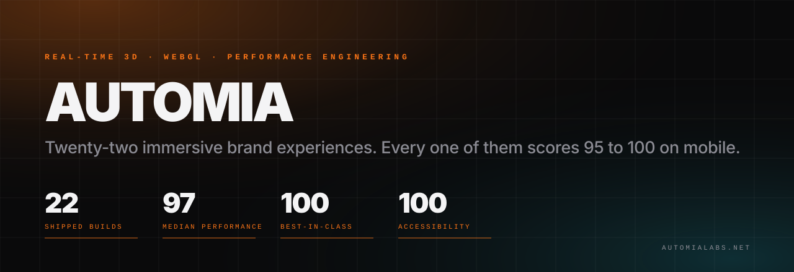

<h3 align="center">Real-time 3D brand experiences that are actually fast.</h3>

  Twenty-two immersive builds for luxury, hospitality, finance and culture. 
  Every one measured on a throttled mobile connection. Every one between <b>95</b> and <b>100</b> on Lighthouse performance.

  
  
  
  
  

---

## The premise

A 3D website usually means a beautiful first second and four seconds of nothing. The scene loads, the
main thread stalls, the hero text arrives late, and the phone gets hot.

These twenty-two builds take the opposite position: **the immersive layer is the reward, not the entry
fee.** Each one paints its real content before a single byte of WebGL arrives, then brings the scene in
the moment you touch the page.

| | |
|---|---|
| **22** | production builds |
| **97** | median performance score |
| **100** | best in class, reached by 2 builds |
| **100** | accessibility, on every single build |
| **≤ 2.8 s** | worst largest contentful paint |

---

## The work

<table>
<tr><td width="50%" valign="top">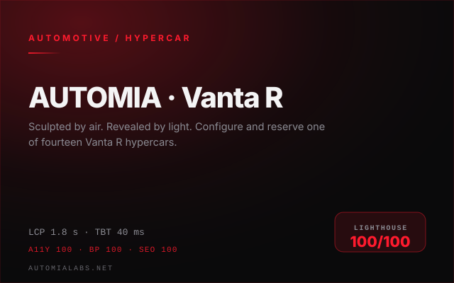</td><td width="50%" valign="top">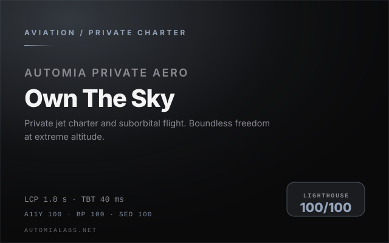</td></tr>
<tr><td width="50%" valign="top">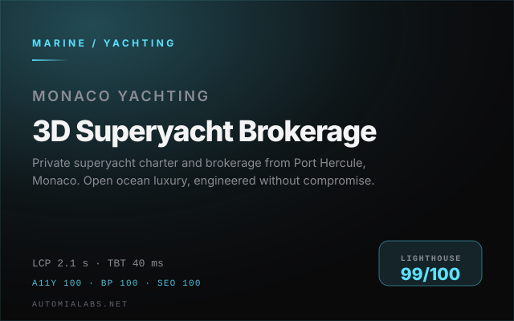</td><td width="50%" valign="top">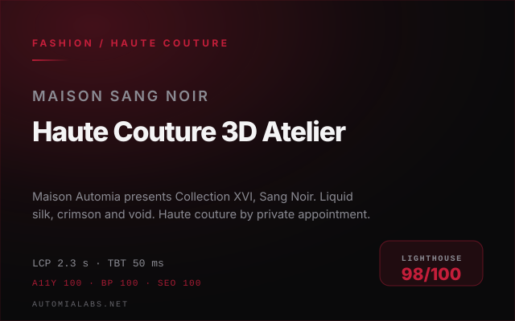</td></tr>
<tr><td width="50%" valign="top">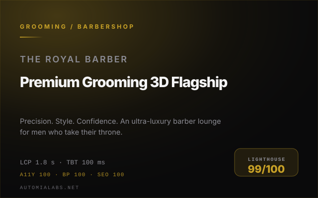</td><td width="50%" valign="top">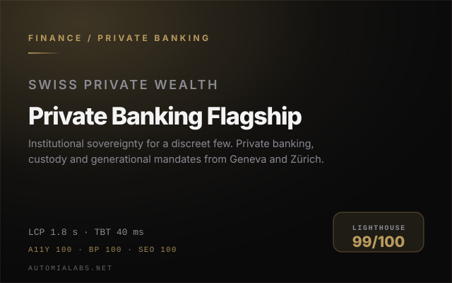</td></tr>
<tr><td width="50%" valign="top">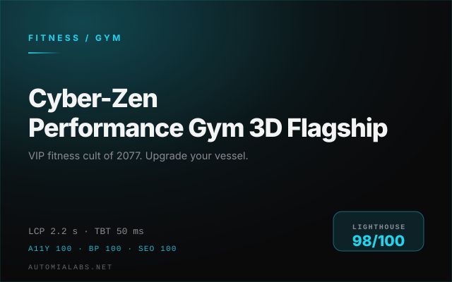</td><td width="50%" valign="top">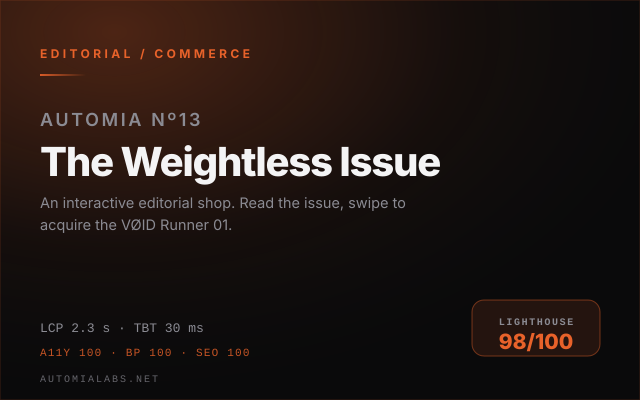</td></tr>
<tr><td width="50%" valign="top">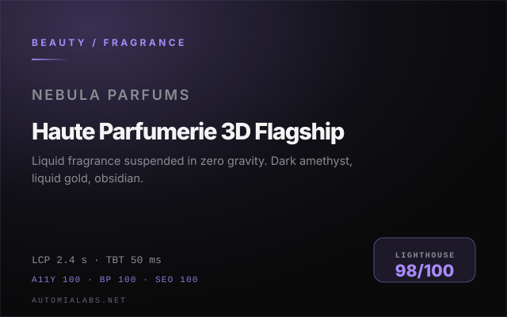</td><td width="50%" valign="top">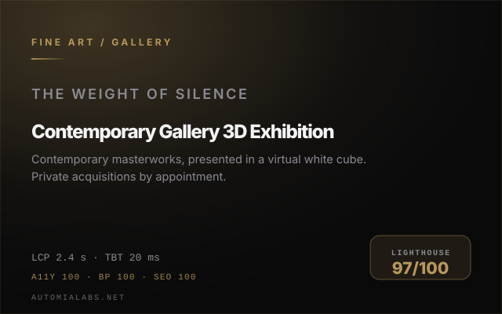</td></tr>
<tr><td width="50%" valign="top">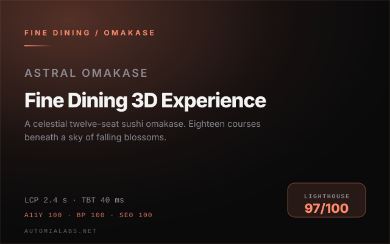</td><td width="50%" valign="top">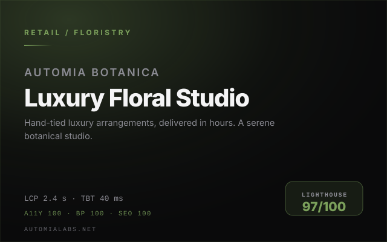</td></tr>
<tr><td width="50%" valign="top">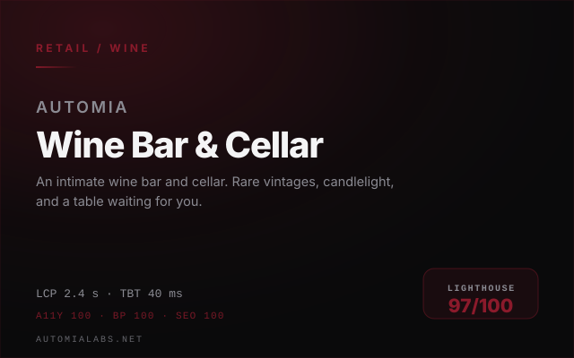</td><td width="50%" valign="top">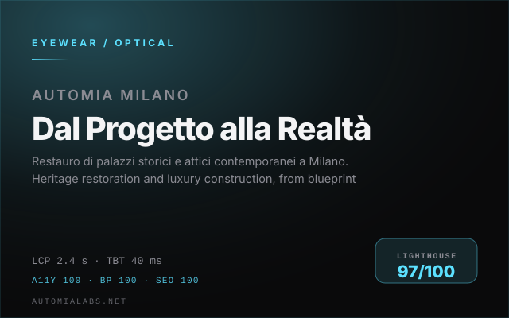</td></tr>
<tr><td width="50%" valign="top">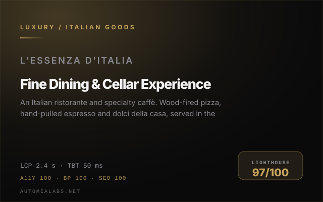</td><td width="50%" valign="top">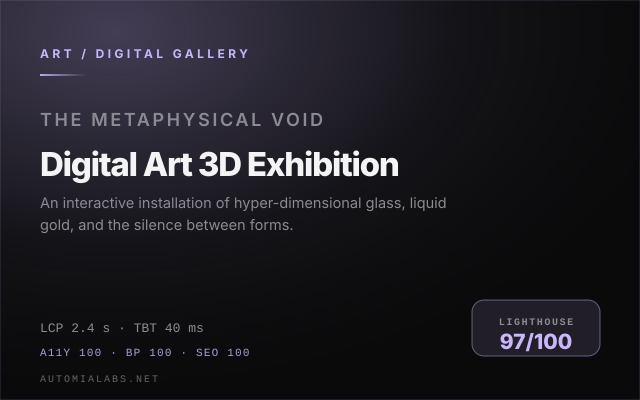</td></tr>
<tr><td width="50%" valign="top">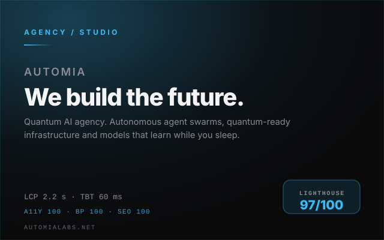</td><td width="50%" valign="top">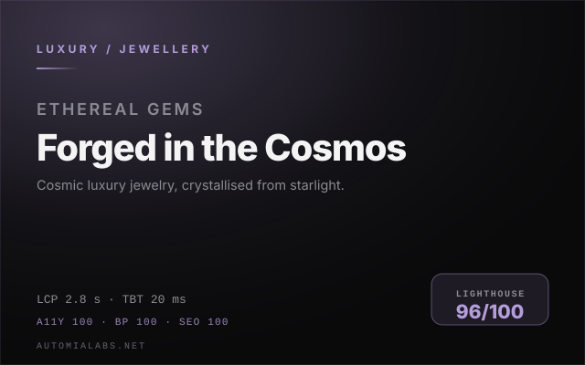</td></tr>
<tr><td width="50%" valign="top">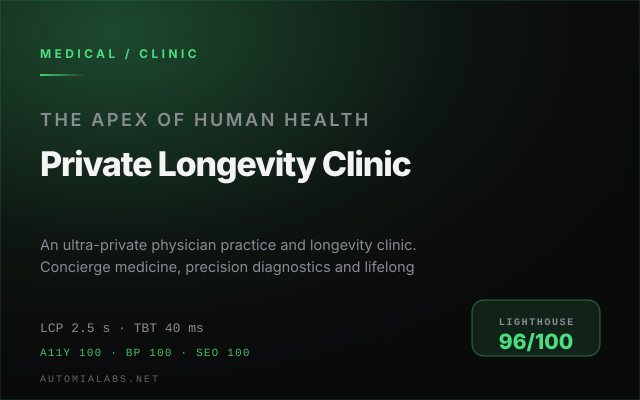</td><td width="50%" valign="top">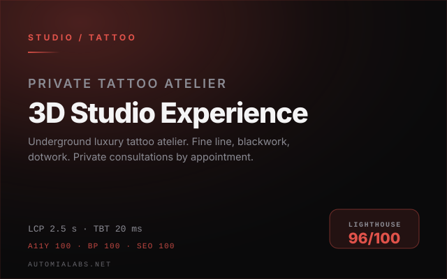</td></tr>
<tr><td width="50%" valign="top">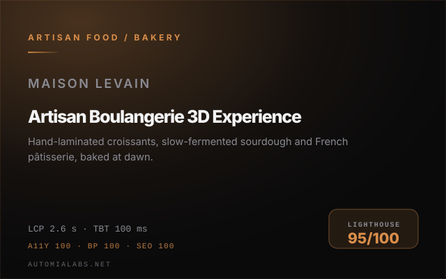</td><td width="50%" valign="top">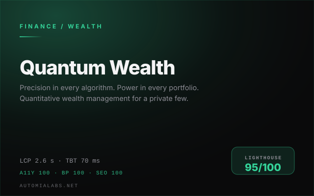</td></tr>
</table>

---

## Performance ledger

Lighthouse 12.8.2 · mobile emulation · simulated throttling · CPU 4x · 412×823 viewport.
"Before" is the same build on the same rig before the performance pass.

| Build | Sector | Before | After | LCP | TBT |
|---|---|---|---|---|---|
| **AUTOMIA · Vanta R** | Automotive / Hypercar | 55 | **100** | 1.8 s | 40 ms |
| **Automia Private Aero — Own The Sky** | Aviation / Private charter | 58 | **100** | 1.8 s | 40 ms |
| **Automia Monaco — Superyacht Brokerage** | Marine / Yachting | 70 | **99** | 2.1 s | 40 ms |
| **Maison Automia — Haute Couture XVI · Sang Noir** | Fashion / Haute couture | 59 | **98** | 2.3 s | 50 ms |
| **The Royal Barber — Premium Men's Grooming Lounge** | Grooming / Barbershop | 62 | **99** | 1.8 s | 100 ms |
| **Automia — Swiss Private Wealth** | Finance / Private banking | 52 | **99** | 1.8 s | 40 ms |
| **AUTOMIA // Cyber-Zen Gym** | Fitness / Gym | 77 | **98** | 2.2 s | 50 ms |
| **AUTOMIA Nº13 — The Weightless Issue** | Editorial / Commerce | 56 | **98** | 2.3 s | 30 ms |
| **Nebula Scents — Gravity-Defying Fragrance** | Beauty / Fragrance | 66 | **98** | 2.4 s | 50 ms |
| **Automia Gallery — The Weight of Silence** | Fine art / Gallery | 66 | **97** | 2.4 s | 20 ms |
| **Astral Omakase — Taste the Cosmos** | Fine dining / Omakase | 43 | **97** | 2.4 s | 40 ms |
| **Automia Botanica — Luxury Floral Studio** | Retail / Floristry | 84 | **97** | 2.4 s | 40 ms |
| **Automia — Wine Bar &amp; Cellar** | Retail / Wine | not deployed | **97** | 2.4 s | 40 ms |
| **Automia Milano — Dal Progetto alla Realtà** | Eyewear / Optical | 65 | **97** | 2.4 s | 40 ms |
| **Automia — L'Essenza d'Italia** | Luxury / Italian goods | 53 | **97** | 2.4 s | 50 ms |
| **The Metaphysical Void — Automia** | Art / Digital gallery | 53 | **97** | 2.4 s | 40 ms |
| **Automia — We build the future.** | Agency / Studio | 68 | **97** | 2.2 s | 60 ms |
| **Ethereal Gems — Forged in the Cosmos** | Luxury / Jewellery | 50 | **96** | 2.8 s | 20 ms |
| **Automia — Private Medicine &amp; Longevity** | Medical / Clinic | 59 | **96** | 2.5 s | 40 ms |
| **AUTOMIA — Boutique Tattoo Studio** | Studio / Tattoo | 53 | **96** | 2.5 s | 20 ms |
| **Maison Levain — Artisan Bakery** | Artisan food / Bakery | 54 | **95** | 2.6 s | 100 ms |
| **Automia Quantum Wealth** | Finance / Wealth | 54 | **95** | 2.6 s | 70 ms |

---

## Three builds, in detail

### AUTOMIA · Vanta R — 55 to 100

A full-bleed WebGL hypercar configurator behind scroll-snap sections. The scene used to mount on
load, so `three` plus scene construction sat directly on the critical path and the first frame
competed with the text for the main thread.

The rebuild defers the canvas entirely: the hero is server-rendered, a CSS poster stands in for the
render, and the scene mounts on first interaction with a delayed fallback. Result: **100/100,
LCP 1.8 s, TBT 40 ms.**

### Automia Private Aero — Own The Sky — 58 to 100

Private aviation, positioned on restraint. Same architectural problem, solved the same way, with the
scene's own palette rendered as a layered gradient poster so the handover from poster to WebGL is
invisible.

**100/100, LCP 1.8 s, TBT 40 ms.**

### Automia — Swiss Private Wealth — 52 to 99

A private banking site where the product *is* trust, so nothing could be cut for speed. What came off
the critical path instead was weight: subsetted variable fonts served locally, deferred scene, no
blocking preloads, and not one above-the-fold element starting at zero opacity.

**99/100, LCP 1.8 s, TBT 40 ms.**

---

## What every build ships with

- **A server-rendered first paint.** Hero copy, headings and chrome are in the HTML. No JavaScript is
  needed to read the page, and none is needed for the entrance to look finished.
- **A real-time 3D layer, deferred.** Three.js and React Three Fiber load on first interaction, on a
  delayed fallback, or never — with a CSS/SVG poster holding the frame in the meantime.
- **Its own bytes.** Local AVIF and WebP at responsive widths, fonts subsetted to the glyphs the page
  renders and served as variable files, zero third-party image or font hosts on the critical path.
- **Accessibility at 100.** Keyboard reachable controls, visible focus, 44 px targets, contrast held,
  motion respecting `prefers-reduced-motion` — audited, not assumed.
- **Motion that never blocks paint.** Above the fold, transform and blur only. Opacity reveals are
  reserved for content below the fold, driven by `IntersectionObserver`.
- **Strict TypeScript and a clean build.** `tsc --noEmit` and `next build` both exit zero, on every repo.

---

## How the scores were reached

Five changes did almost all of the work, in this order of impact:

1. **Take React off the splash path.** Static markup is served for the first screen; the client
   runtime hydrates around it rather than gating it.
2. **Own the font bytes.** `next/font/google` emits one file per weight per unicode range — 226 KB on
   one of these builds, 737 KB on another before their CSS could paint. Subsetted to the glyphs
   actually used and self-hosted as variable faces: 91 KB and 90 KB, two requests each.
3. **Nothing above the fold starts invisible.** An `opacity: 0` hero waits for JavaScript, and the
   first contentful paint moves with it. Transform-only entrance animations removed the delay.
4. **Mount the scene late, and late enough.** A six-second fallback looked deferential but landed
   inside the first-load window, dropping one build to 58 on a slow run. It is now twenty seconds;
   interacting still mounts instantly.
5. **Measure, then argue.** Every claim above comes from a Lighthouse JSON on a fixed rig — same
   Chrome build, same throttling, same viewport — and every build was re-measured after its changes.

---

## Stack

`Next.js 14 App Router` · `React 18` · `TypeScript strict` · `Three.js` · `React Three Fiber` ·
`Tailwind CSS` · `Framer Motion` · `Lighthouse 12.8.2` for the rig

---

## Working together

The source for these builds is private. I am glad to walk through any of them live, share the
performance evidence, or scope a build for your brand.

**Hello@automialabs.net**

Twenty-two builds. Median 97. One standard.

